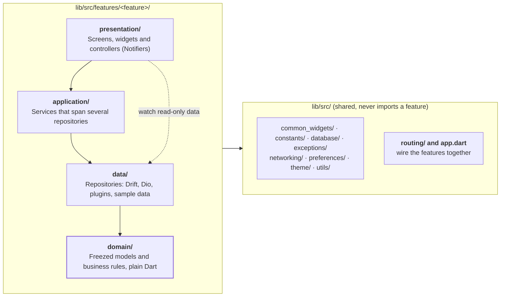

# Architecture

Noctua follows the architecture Andrea Bizzotto describes for Riverpod apps. Read his articles for the reasoning; this section is the short version, with the names this project uses.

- [Introduction](https://codewithandrea.com/articles/flutter-app-architecture-riverpod-introduction/) and [project structure](https://codewithandrea.com/articles/flutter-project-structure/)
- One article per layer: [presentation](https://codewithandrea.com/articles/flutter-presentation-layer/), [application](https://codewithandrea.com/articles/flutter-app-architecture-application-layer/), [domain](https://codewithandrea.com/articles/flutter-app-architecture-domain-model/), [data (repositories)](https://codewithandrea.com/articles/flutter-repository-pattern/)



*Arrows point at what a part may use. Every layer may also use domain models. Dashed: widgets may watch a repository's read-only data; changes go through a controller.*

## The four layers

| Layer | What goes in it | Noctua examples | Tested with |
| --- | --- | --- | --- |
| **Presentation** | Screens and widgets, plus **controllers**: `Notifier` or `AsyncNotifier` classes that hold one screen's state and run its actions. Widgets watch providers and call controller methods; they hold no business logic. | `LibraryPage`, `LibraryFilterController`, `SignInController`, `AppUpdateController` | Widget tests |
| **Application** | Optional **services**: stateless classes that take a `Ref` and carry out an action spanning several repositories. Only add one when a controller would otherwise talk to three repositories. | `AuthService` (auth server + session + tabs + preferences), `AppUpdateService` (releases + installed app + preferences + installer) | Unit tests with `ProviderContainer` |
| **Domain** | Immutable models (Freezed) and the rules that work on them. Plain Dart: no Flutter, no I/O, no Riverpod. | `Work`, `LibraryFilter.matches`, `sortWorks`, `AppVersion`, `pickUpdate` | Plain unit tests |
| **Data** | **Repositories**: one concrete class per data source (Drift, Dio, a plugin, sample data) that returns domain models, each exposed by an `xRepositoryProvider`. Tests swap in a fake that `implements` the concrete class. | `ReleasesRepository` + `FakeReleasesRepository`, `WorksRepository`, `ChaptersRepository`, `TabsRepository` | Unit tests, with a fake HTTP adapter or in-memory Drift |

The rules that keep it this way:

- **Dependencies point down.** Presentation may use application, domain and data providers. Application uses domain and data. Data uses domain only. Domain imports nothing but other domain files.
- **Widgets read, controllers act.** A widget may `ref.watch` a repository's read-only data (`workProvider(id)`, `libraryCategoriesProvider`). Anything that changes state or can fail goes through a controller (or a repository-with-a-cache method, below), so errors end up in an `AsyncValue` instead of an uncaught exception.
- **Shared code never imports a feature.** Folders outside `features/` (`common_widgets`, `database`, `preferences`, `theme`…) are used by features, never the other way round. `app.dart` and `routing/` are the exception: they wire features together.
- **A feature is a functional requirement, not a screen.** `library` owns the library screen, its filters, categories and selection; `reader` owns chapter text, highlights and every reader sheet.

## Patterns you'll see in every milestone

**Concrete repositories with fakes.** A repository is a plain class. There's no abstract interface: the fake is declared `class FakeReleasesRepository implements ReleasesRepository`, which Dart allows for any class, and tests override the provider with it.

```dart
class ReleasesRepository {
  ReleasesRepository(this._dio);
  final Dio _dio;
  Future<List<AppRelease>> fetchReleases() async { … }
}

@Riverpod(keepAlive: true)
ReleasesRepository releasesRepository(Ref ref) => ReleasesRepository(ref.watch(dioProvider));

// in a test
releasesRepositoryProvider.overrideWithValue(const FakeReleasesRepository()),
```

Until the sync server and source extensions exist, most repositories serve sample data from inside their methods. The screens can't tell, so replacing a method body with a network call later changes one file.

**Repositories with a cache.** Some data must be readable synchronously by every screen and survive restarts: preferences, open tabs, the library membership, the session. These repositories are `Notifier`s whose `state` is the cache. Their methods update `state` first (the UI changes at once) and then write through to Drift:

```dart
@Riverpod(keepAlive: true)
class TabsRepository extends _$TabsRepository {
  @override
  List<TabEntry> build() => ref.read(initialTabsProvider); // loaded in main()

  void close(String workId) {
    state = state.where((t) => t.workId != workId).toList();
    _persist(); // writes the open_tabs table
  }
}
```

**Controllers with `AsyncValue.guard`.** A controller for an action has `AsyncValue<void>` state. It sets loading, runs the action through `AsyncValue.guard` (which catches the exception and returns `AsyncError`), and returns whether it worked so the screen can navigate:

```dart
@riverpod
class ForgotPasswordController extends _$ForgotPasswordController with _Guard {
  @override
  FutureOr<void> build() {}

  Future<bool> send(String email) => guard(() => ref.read(authServiceProvider).requestPasswordReset(email));
}

// in the screen
final state = ref.watch(forgotPasswordControllerProvider);
BusyButton(busy: state.isLoading, onPressed: _send);
if (authErrorMessage(state.error) case final message?) AuthErrorBanner(message);
```

Screens that only need to report a failure use `ref.listen(controllerProvider, (_, state) => state.showSnackbarOnError(context))` from `utils/async_value_ui.dart`.

**Names.** Generated providers are named after their class or function: `WorksRepository` → `worksRepositoryProvider`, `LibraryFilterController` → `libraryFilterControllerProvider`, `@riverpod Work work(Ref ref, String id)` → `workProvider(id)`. Classes end in what they are (`…Repository`, `…Service`, `…Controller`), so the layer is visible at every call site.

**Tests mirror `lib/`.** `lib/src/features/library/domain/library_filter.dart` is tested by `test/src/features/library/domain/library_filter_test.dart`. App-wide widget tests sit in `test/src/`.

---
← [[01 Overview]] · [[00 Index|Index]] · [[Milestone 01 - Project setup and the folder structure]] →
