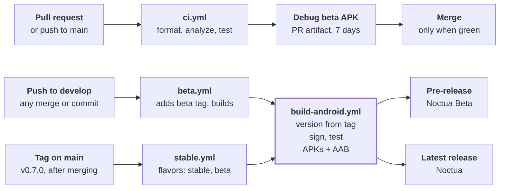

# Milestone 2: Release pipeline for beta and stable

Set up releases before writing features, so the very first build can go to testers. Branches drive releases: every push to `develop` publishes the next beta (`v0.1.0-beta.1`, `-beta.2`, …) without anyone tagging, and a `vX.Y.Z` tag on `main` publishes a stable release. The two channels are Android product flavors, so Noctua and Noctua Beta install side by side, and every pull request is checked before it can merge. Until [[Milestone 03 - In-app updates|milestone 3]] replaces it, the counter app and its default widget test are what CI builds and runs.

**1. Flavors with flutter\_flavorizr.** Describe both apps in `pubspec.yaml` and let flavorizr write the Gradle flavors. Limit it to these four processors: its defaults also replace `lib/main.dart` and add sample pages, which you don’t want once the app exists.

```yaml
flavorizr:
  app:
    android:
      flavorDimensions: "channel"
  flavors:
    stable:
      app: { name: "Noctua" }
      android: { applicationId: "dev.noctua.noctua" }
    beta:
      app: { name: "Noctua Beta" }
      android: { applicationId: "dev.noctua.noctua.beta" }
  instructions:
    - android:androidManifest      # android:label="@string/app_name", set per flavor
    - android:flavorizrGradle      # writes android/app/flavorizr.gradle.kts
    - android:buildGradle          # applies it from build.gradle.kts
    - flutter:flavors              # writes lib/flavors.dart (enum Flavor, class F)
```

Run `dart run flutter_flavorizr`, then `dart format lib/flavors.dart` (CI checks formatting). In `main()`, set the flavor from Flutter’s own `appFlavor` constant, which `--flavor` fills in, so one `lib/main.dart` serves both apps:

```dart
F.appFlavor = Flavor.values.asNameMap()[appFlavor] ?? Flavor.stable;
```

**Signing** stays hand-written in `android/app/build.gradle.kts`, next to the line flavorizr adds:

```kotlin
val keyProperties = Properties().apply {
    val file = rootProject.file("key.properties")
    if (file.exists()) file.inputStream().use { load(it) }
}

android {
    signingConfigs {
        create("release") {
            if (keyProperties.isNotEmpty()) {
                storeFile = rootProject.file(keyProperties.getProperty("storeFile"))
                storePassword = keyProperties.getProperty("storePassword")
                keyAlias = keyProperties.getProperty("keyAlias")
                keyPassword = keyProperties.getProperty("keyPassword")
            }
        }
    }
    buildTypes {
        release {
            signingConfig = if (keyProperties.isNotEmpty()) signingConfigs.getByName("release")
                            else signingConfigs.getByName("debug")
        }
    }
}

// ----- BEGIN flavorDimensions (autogenerated by flutter_flavorizr) -----
apply { from("flavorizr.gradle.kts") }
// ----- END flavorDimensions (autogenerated by flutter_flavorizr) -----
```

Add `android/key.properties`, `*.jks`, `*.g.dart`, `*.gr.dart` and `*.freezed.dart` to `.gitignore`: keys come from secrets, and generated code is rebuilt in CI.

**Launcher icons and splash screen, per flavor.** The logo is a mauve (`#CBA6F7`) disc with the owl cut out; the beta app uses the same art in Catppuccin peach (`#FAB387`), so testers can tell the two apps apart at a glance. Keep the artwork in `assets/branding/`: a full icon, an adaptive foreground scaled into the central 62%, a white monochrome version for Android 13 themed icons, and splash marks. Both generators read one config file per flavor:

```yaml
# flutter_launcher_icons-beta.yaml   (and -stable.yaml)
flutter_launcher_icons:
  android: "ic_launcher"
  ios: false
  image_path: "assets/branding/icon_beta.png"
  min_sdk_android: 21
  adaptive_icon_background: "#1E1E2E"        # Mocha base shows through the owl
  adaptive_icon_foreground: "assets/branding/icon_foreground_beta.png"
  adaptive_icon_monochrome: "assets/branding/icon_monochrome.png"
```

```yaml
# flutter_native_splash-beta.yaml   (and -stable.yaml)
flutter_native_splash:
  color: "#EFF1F5"                            # Latte in light mode
  color_dark: "#1E1E2E"                       # Mocha in dark mode
  image: assets/branding/splash_beta_legacy.png
  image_dark: assets/branding/splash_beta_legacy.png
  branding: assets/branding/wordmark_beta_light.png
  branding_dark: assets/branding/wordmark_beta_dark.png
  android_12:
    color: "#EFF1F5"
    color_dark: "#1E1E2E"
    image: assets/branding/splash_beta.png    # logo inside Android 12's circle
    image_dark: assets/branding/splash_beta.png
  ios: false
  web: false
```

Generate both with `dart run flutter_launcher_icons` and `dart run flutter_native_splash:create --flavors stable,beta`; they write into `android/app/src/<flavor>/res/`, so commit those folders. Keep the splash up until startup work finishes:

```dart
final binding = WidgetsFlutterBinding.ensureInitialized();
FlutterNativeSplash.preserve(widgetsBinding: binding);
// … open the database, load preferences, tabs and session …
runApp(ProviderScope(overrides: [...], child: NoctuaApp(router: router)));
FlutterNativeSplash.remove();
```

The app’s own screens show the same logo through `NoctuaLogo` (`lib/src/common_widgets/`, [[Milestone 05 - Theming and the app shell|milestone 5]]), a white alpha mask tinted with the theme’s primary colour, so it follows every theme including E-ink.

Locally you now run `flutter run --flavor beta` (or `stable`).

![[noctua-m02-launcher-icons.png]]
*The Noctua (mauve) and Noctua Beta (peach) launcher icons, with their monochrome and adaptive variants*

**2. Create the upload key once and store it as secrets.** Keep the `.jks` file and its passwords somewhere safe outside the repository; losing them means users can’t upgrade in place.

```bash
keytool -genkey -v -keystore upload.jks -keyalg RSA -keysize 4096 -validity 10000 -alias upload
base64 -w0 upload.jks   # paste the output into ANDROID_KEYSTORE_BASE64
```

| Repository secret | Value |
| --- | --- |
| `ANDROID_KEYSTORE_BASE64` | The base64 of `upload.jks` |
| `ANDROID_KEYSTORE_PASSWORD` | The keystore password |
| `ANDROID_KEY_ALIAS` | `upload` |
| `ANDROID_KEY_PASSWORD` | The key password |

**3. Add four workflow files** in `.github/workflows/`:

| File | Runs on | Does |
| --- | --- | --- |
| `ci.yml` | Every pull request; pushes to `main` | build\_runner, `dart format --set-exit-if-changed`, `flutter analyze`, `flutter test`; on PRs also a debug beta APK as a 7-day artifact |
| `build-android.yml` | Called by the two below (`workflow_call`) with a tag | Version from the tag, signing, tests, then for each flavor: split APKs and an app bundle; SHA-256 sums; the GitHub release |
| `beta.yml` | Every push to `develop` (Markdown-only changes skipped) | Reads the version from `pubspec.yaml`, picks the next beta number from existing tags, pushes that tag, then builds `flavors: beta` as a pre-release. Runs one at a time so two pushes never get the same number |
| `stable.yml` | Tags matching `v*` but not `v*-*` | Builds `flavors: stable beta`, publishes the latest release. The beta-flavor APKs let testers on Noctua Beta roll onto each stable release |



*Develop builds betas, main tags build stable; one shared build.*

The two channel workflows are a few lines each, so the channels can never drift apart:

```yaml
# .github/workflows/beta.yml
name: Beta release
on:
  push:
    branches: [develop]
    paths-ignore: ['**.md', 'docs/**']
concurrency: { group: beta-release, cancel-in-progress: false }
jobs:
  tag:
    runs-on: ubuntu-latest
    permissions: { contents: write }
    outputs: { tag: '${{ steps.next.outputs.tag }}' }
    steps:
      - uses: actions/checkout@v4
        with: { fetch-depth: 0, fetch-tags: true }
      - id: next
        run: |
          base=$(sed -nE 's/^version:[[:space:]]*([0-9]+\.[0-9]+\.[0-9]+).*/\1/p' pubspec.yaml)   # 0.7.0
          last=$(git tag -l "v$base-beta.*" | sed -E 's/.*-beta\.//' | sort -n | tail -1)
          tag="v$base-beta.$(( ${last:-0} + 1 ))"                                          # v0.7.0-beta.4
          git tag "$tag" "$GITHUB_SHA" && git push origin "$tag"
          echo "tag=$tag" >> "$GITHUB_OUTPUT"
  build:
    needs: tag
    uses: ./.github/workflows/build-android.yml
    with:
      tag: ${{ needs.tag.outputs.tag }}
      flavors: beta
      prerelease: true
    secrets: inherit
```

The real file also stops with a clear error when `pubspec.yaml` still names a version that is already released, so a forgotten version bump can’t publish betas that sort below stable.

```yaml
# .github/workflows/stable.yml
name: Stable release
on:
  push:
    tags: ['v*', '!v*-*']
jobs:
  build:
    uses: ./.github/workflows/build-android.yml
    with:
      tag: ${{ github.ref_name }}
      flavors: stable beta   # beta too, so testers update onto every stable release
      prerelease: false
    secrets: inherit
```

The shared build turns the tag into a version name and a version code. Betas get build numbers 1–998 and the stable release 999, so a stable build always upgrades the betas of the same version, and a busy `develop` branch has room for hundreds of betas per version:

```bash
tag="${TAG#v}"                        # 1.5.0-beta.3
[[ "$tag" =~ ^([0-9]+)\.([0-9]+)\.([0-9]+)(-beta\.([0-9]+))?$ ]] || exit 1
major=${BASH_REMATCH[1]} minor=${BASH_REMATCH[2]} patch=${BASH_REMATCH[3]} beta=${BASH_REMATCH[5]:-999}
echo "name=$tag" >> "$GITHUB_OUTPUT"
echo "code=$(( major * 10000000 + minor * 100000 + patch * 1000 + beta ))" >> "$GITHUB_OUTPUT"   # 10500003
```

Then it builds and publishes:

```yaml
- name: Build APKs and app bundles
  # The in-app updater (milestone 3) looks for noctua-<flavor>-<version>-<abi>.apk.
  run: |
    mkdir -p dist
    name=${{ steps.version.outputs.name }}
    for flavor in ${{ inputs.flavors }}; do
      common="--release --flavor $flavor --build-name $name --build-number ${{ steps.version.outputs.code }}"
      flutter build apk $common --split-per-abi --android-project-arg=force-version-code-ignoring-abi=true
      flutter build appbundle $common
      for f in build/app/outputs/flutter-apk/app-*-$flavor-release.apk; do
        abi=$(basename "$f" | sed -E "s/app-(.*)-$flavor-release.apk/\1/")
        cp "$f" "dist/noctua-$flavor-$name-$abi.apk"
      done
      cp "build/app/outputs/bundle/${flavor}Release/app-$flavor-release.aab" "dist/noctua-$flavor-$name.aab"
    done
    (cd dist && sha256sum * > SHA256SUMS.txt)
- uses: softprops/action-gh-release@v2
  with:
    name: Noctua ${{ steps.version.outputs.name }}
    prerelease: ${{ inputs.prerelease }}
    make_latest: ${{ !inputs.prerelease }}
    generate_release_notes: true
    files: dist/*
```

| What you do | Tag the workflow creates or uses | Apps built | Version code | GitHub release |
| --- | --- | --- | --- | --- |
| Push to `develop` (pubspec says 0.1.0) | `v0.1.0-beta.1`, added for you | Noctua Beta (`dev.noctua.noctua.beta`) | 100001 | Pre-release |
| Push to `develop` again | `v0.1.0-beta.2`, added for you | Noctua Beta | 100002 | Pre-release |
| Merge to `main`, tag `v0.1.0` | `v0.1.0` | Noctua (`dev.noctua.noctua`) and Noctua Beta | 100999 | Latest |
| Bump pubspec to 0.2.0 on `develop`, push | `v0.2.0-beta.1`, added for you | Noctua Beta | 200001 | Pre-release |

**4. Try it yourself, invite testers after [[Milestone 03 - In-app updates|milestone 3]].** Install the first beta from its release page (`noctua-beta-<version>-arm64-v8a.apk`, or `armeabi-v7a` on older phones) to check the signing and flavors work. Hold the tester invite until [[Milestone 03 - In-app updates|milestone 3]]’s build: it is the first that updates itself, so it is the only APK testers ever install by hand.

**5. Release:**

```bash
# Beta: just push. The workflow tags and publishes v<pubspec version>-beta.<next>.
git switch develop && git push origin develop

# Stable: merge, tag main, then start the next version on develop.
git switch main && git merge --ff-only develop && git tag v0.1.0 && git push origin main v0.1.0
git switch develop && sed -i 's/^version: .*/version: 0.2.0+1/' pubspec.yaml
git commit -am "Start 0.2.0" && git push origin develop   # → v0.2.0-beta.1
```

**Later: Google Play.** Releases go through GitHub only for now, but nothing here blocks a Play listing later: every release already builds an `.aab`, the two flavors have their own application IDs, and `--dart-define=PLAY_STORE=true` turns the in-app updater off (Play doesn’t allow self-updating apps). When you’re ready, enrol in Play App Signing with the existing upload key, then add a step after the build that uploads the `.aab` with `r0adkll/upload-google-play@v1`, sending beta to the `beta` track and stable to `production`, using a service-account JSON stored as another secret. New personal developer accounts must run a closed test with a minimum number of testers before production is unlocked, so start that early; check Play’s current requirements when you get there.

## Code walkthrough: milestone 2

These are the finished versions of every file this milestone touches, in the order you create them.

**Step 1: the flavor config in `pubspec.yaml`.** flutter_flavorizr reads this block. `flavorDimensions` names the one axis the flavors vary on; each flavor sets the app name (shown under the launcher icon) and the application ID (what Android uses to tell apps apart, so different IDs install side by side). `instructions` limits flavorizr to the four processors Noctua needs; without it, flavorizr also rewrites `main.dart`, adds iOS schemes and replaces your app icons.

```yaml
# Flavors: `dart run flutter_flavorizr` writes android/app/flavorizr.gradle.kts and
# lib/flavors.dart. Only these processors run, so it never touches lib/main.dart or the app code.
flavorizr:
  app:
    android:
      flavorDimensions: "channel"
  flavors:
    stable:
      app:
        name: "Noctua"
      android:
        applicationId: "dev.noctua.noctua"
    beta:
      app:
        name: "Noctua Beta"
      android:
        applicationId: "dev.noctua.noctua.beta"
  instructions:
    - android:androidManifest
    - android:flavorizrGradle
    - android:buildGradle
    - flutter:flavors
```

Run it with the processors listed, then format what it generated:

```bash
dart run flutter_flavorizr -p android:androidManifest,android:flavorizrGradle,android:buildGradle,flutter:flavors
dart format lib/flavors.dart
```

**Step 2: what flavorizr generates.** `android/app/flavorizr.gradle.kts` declares the two product flavors. `resValue` creates a string resource called `app_name` per flavor, which the manifest uses as the label:

```kotlin
import com.android.build.gradle.AppExtension

val android = project.extensions.getByType(AppExtension::class.java)

android.apply {
    flavorDimensions("channel")

    productFlavors {
        create("stable") {
            dimension = "channel"
            applicationId = "dev.noctua.noctua"
            resValue(type = "string", name = "app_name", value = "Noctua")
        }
        create("beta") {
            dimension = "channel"
            applicationId = "dev.noctua.noctua.beta"
            resValue(type = "string", name = "app_name", value = "Noctua Beta")
        }
    }

    buildFeatures.resValues = true
}
```

`lib/flavors.dart` gives Dart code the same names. `F.appFlavor` is set once in `main()`:

```dart
enum Flavor { stable, beta }

class F {
  static late final Flavor appFlavor;

  static String get name => appFlavor.name;

  static String get title {
    switch (appFlavor) {
      case Flavor.stable:
        return 'Noctua';
      case Flavor.beta:
        return 'Noctua Beta';
    }
  }
}
```

```dart
// lib/main.dart, first lines of main()
final binding = WidgetsFlutterBinding.ensureInitialized();
FlutterNativeSplash.preserve(widgetsBinding: binding);
// appFlavor (from package:flutter/services.dart) is the name passed to --flavor.
F.appFlavor = Flavor.values.asNameMap()[appFlavor] ?? Flavor.stable;
```

`appFlavor` is null under `flutter test`, so tests run as stable unless they set `F.appFlavor` themselves.

**Step 3: `android/app/build.gradle.kts`.** Keep your own settings here and let flavorizr own its separate file. The parts that matter:

- `keyProperties` loads `android/key.properties` if it exists. CI writes that file from secrets; on your machine it usually doesn't exist.
- The `release` signing config is only filled in when the properties were found.
- The `release` build type falls back to the debug key, so `flutter run --release` works locally without the upload key.
- The last three lines are flavorizr's; they pull in `flavorizr.gradle.kts`.

```kotlin
import java.util.Properties

plugins {
    id("com.android.application")
    // The Flutter Gradle Plugin must be applied after the Android and Kotlin Gradle plugins.
    id("dev.flutter.flutter-gradle-plugin")
}

// Release signing comes from android/key.properties (written by CI from secrets; never committed).
val keyProperties = Properties().apply {
    val file = rootProject.file("key.properties")
    if (file.exists()) file.inputStream().use { load(it) }
}

android {
    namespace = "dev.noctua.noctua"
    compileSdk = flutter.compileSdkVersion
    ndkVersion = flutter.ndkVersion

    compileOptions {
        sourceCompatibility = JavaVersion.VERSION_17
        targetCompatibility = JavaVersion.VERSION_17
    }

    defaultConfig {
        applicationId = "dev.noctua.noctua"
        // You can update the following values to match your application needs.
        // For more information, see: https://flutter.dev/to/review-gradle-config.
        minSdk = flutter.minSdkVersion
        targetSdk = flutter.targetSdkVersion
        // Uses the version code from pubspec.yaml. When using split APKs, 1000 * ABI_VERSION
        // is added automatically by Flutter. (https://developer.android.com/studio/build/configure-apk-splits#configure-APK-versions)
        // You can force using the value of versionCode by specifying the `-P force-version-code-ignoring-abi=true`
        // flag during build.
        versionCode = flutter.versionCode
        versionName = flutter.versionName
    }

    signingConfigs {
        create("release") {
            if (keyProperties.isNotEmpty()) {
                storeFile = rootProject.file(keyProperties.getProperty("storeFile"))
                storePassword = keyProperties.getProperty("storePassword")
                keyAlias = keyProperties.getProperty("keyAlias")
                keyPassword = keyProperties.getProperty("keyPassword")
            }
        }
    }

    // Flavors (stable, beta) live in flavorizr.gradle.kts, generated by flutter_flavorizr from pubspec.yaml.

    buildTypes {
        release {
            // Debug keys when no key.properties exists, so local `flutter run --release` still works.
            signingConfig = if (keyProperties.isNotEmpty()) signingConfigs.getByName("release") else signingConfigs.getByName("debug")
        }
    }
}

kotlin {
    compilerOptions {
        jvmTarget = org.jetbrains.kotlin.gradle.dsl.JvmTarget.JVM_17
    }
}

flutter {
    source = "../.."
}
// ----- BEGIN flavorDimensions (autogenerated by flutter_flavorizr) -----
apply { from("flavorizr.gradle.kts") }
// ----- END flavorDimensions (autogenerated by flutter_flavorizr) -----
```

**Step 4: the manifest.** Two changes from Flutter's template: the label points at the per-flavor string, and the `tools` namespace is declared so [[Milestone 03 - In-app updates|milestone 3]] can strip permissions it doesn't want. The file as it ends up after [[Milestone 03 - In-app updates|milestone 3]]:

```xml
<manifest xmlns:android="http://schemas.android.com/apk/res/android" xmlns:tools="http://schemas.android.com/tools">
  <uses-permission android:name="android.permission.INTERNET"/>
  <!-- In-app updates from GitHub Releases (ota_update). The plugin also asks for these two; the app doesn't need them. -->
  <uses-permission android:name="android.permission.REQUEST_INSTALL_PACKAGES"/>
  <uses-permission android:name="android.permission.INSTALL_PACKAGES" tools:node="remove"/>
  <uses-permission android:name="android.permission.WRITE_EXTERNAL_STORAGE" tools:node="remove"/>
  <application android:label="@string/app_name" android:name="${applicationName}" android:icon="@mipmap/ic_launcher">
    <activity android:name=".MainActivity" android:exported="true" android:launchMode="singleTop" android:taskAffinity="" android:theme="@style/LaunchTheme" android:configChanges="orientation|keyboardHidden|keyboard|screenSize|smallestScreenSize|locale|layoutDirection|fontScale|screenLayout|density|uiMode" android:hardwareAccelerated="true" android:windowSoftInputMode="adjustResize">
      <!-- Specifies an Android theme to apply to this Activity as soon as
                 the Android process has started. This theme is visible to the user
                 while the Flutter UI initializes. After that, this theme continues
                 to determine the Window background behind the Flutter UI. -->
      <meta-data android:name="io.flutter.embedding.android.NormalTheme" android:resource="@style/NormalTheme"/>
      <intent-filter>
        <action android:name="android.intent.action.MAIN"/>
        <category android:name="android.intent.category.LAUNCHER"/>
      </intent-filter>
    </activity>
    <!-- Don't delete the meta-data below.
             This is used by the Flutter tool to generate GeneratedPluginRegistrant.java -->
    <meta-data android:name="flutterEmbedding" android:value="2"/>
    <!-- ota_update: hands the downloaded APK to the installer and reports the result -->
    <provider android:name="sk.fourq.otaupdate.OtaUpdateFileProvider" android:authorities="${applicationId}.ota_update_provider" android:exported="false" android:grantUriPermissions="true">
      <meta-data android:name="android.support.FILE_PROVIDER_PATHS" android:resource="@xml/filepaths"/>
    </provider>
    <receiver android:name="sk.fourq.otaupdate.InstallResultReceiver" android:exported="false">
      <intent-filter>
        <action android:name="${applicationId}.ACTION_INSTALL_COMPLETE"/>
      </intent-filter>
    </receiver>
  </application>
  <!-- Required to query activities that can process text, see:
         https://developer.android.com/training/package-visibility and
         https://developer.android.com/reference/android/content/Intent#ACTION_PROCESS_TEXT.

         In particular, this is used by the Flutter engine in io.flutter.plugin.text.ProcessTextPlugin. -->
  <queries>
    <intent>
      <action android:name="android.intent.action.VIEW"/>
      <data android:scheme="https"/>
    </intent>
    <intent>
      <action android:name="android.intent.action.PROCESS_TEXT"/>
      <data android:mimeType="text/plain"/>
    </intent>
  </queries>
</manifest>
```

**Step 5: launcher icons and splash per flavor.** One file per flavor for each generator, named `<generator>-<flavor>.yaml`, so the generators find them with `--flavors`. The launcher icon config:

```yaml
# Launcher icons for the beta flavor: dart run flutter_launcher_icons
# Writes android/app/src/beta/res/mipmap-*; artwork lives in assets/branding/.
flutter_launcher_icons:
  android: "ic_launcher"
  ios: false
  image_path: "assets/branding/icon_beta.png"
  min_sdk_android: 21
  adaptive_icon_background: "#1E1E2E"
  adaptive_icon_foreground: "assets/branding/icon_foreground_beta.png"
  adaptive_icon_monochrome: "assets/branding/icon_monochrome.png"
```

- `image_path` is the legacy square icon for Android 7 and older.
- `adaptive_icon_background` and `adaptive_icon_foreground` make the Android 8+ adaptive icon. The launcher masks it to a circle or squircle and only shows the middle 72 of 108 dp, so the foreground art sits inside the central 62%.
- `adaptive_icon_monochrome` is the white silhouette Android 13+ tints for themed icons.

The splash config for the same flavor:

```yaml
# Splash screen for the beta flavor: dart run flutter_native_splash:create --flavors stable,beta
# The logo with the system theme behind it: Catppuccin Latte in light mode, Mocha in dark mode.
flutter_native_splash:
  color: "#EFF1F5"
  image: assets/branding/splash_beta_legacy.png
  branding: assets/branding/wordmark_beta_light.png
  color_dark: "#1E1E2E"
  image_dark: assets/branding/splash_beta_legacy.png
  branding_dark: assets/branding/wordmark_beta_dark.png
  android_12:
    color: "#EFF1F5"
    image: assets/branding/splash_beta.png
    branding: assets/branding/wordmark_beta_light.png
    color_dark: "#1E1E2E"
    image_dark: assets/branding/splash_beta.png
    branding_dark: assets/branding/wordmark_beta_dark.png
  ios: false
  web: false
```

- `color` and `color_dark` are the window background before Flutter draws anything (Latte and Mocha).
- `image` is the centred logo on Android 11 and older; `android_12.image` is the logo inside Android 12's circular splash icon, which crops anything outside its middle two thirds.
- `branding` is the wordmark at the bottom.

```bash
dart run flutter_launcher_icons          # finds flutter_launcher_icons-<flavor>.yaml by itself
dart run flutter_native_splash:create --flavors stable,beta
```

Both write into `android/app/src/stable/res/` and `android/app/src/beta/res/`. Commit those folders: CI doesn't regenerate them.

**Step 6: the workflows.** `ci.yml` runs on every pull request. The first job is the gate: the same commands you run locally, in the same order. The second proves the beta flavor still compiles and attaches the debug APK to the PR, so a reviewer can install it.

```yaml
# Checks every pull request and every push to main: generated code, formatting, lints, tests.
name: CI

on:
  pull_request:
  push:
    branches: [main]

concurrency:
  group: ci-${{ github.ref }}
  cancel-in-progress: true

env:
  FLUTTER_VERSION: 3.47.9

jobs:
  check:
    runs-on: ubuntu-latest
    timeout-minutes: 20
    steps:
      - uses: actions/checkout@v4

      - uses: subosito/flutter-action@v2
        with:
          flutter-version: ${{ env.FLUTTER_VERSION }}
          channel: stable
          cache: true

      - run: flutter pub get
      - run: dart run build_runner build --delete-conflicting-outputs
      - run: dart format --output=none --set-exit-if-changed lib test
      - run: flutter analyze
      - run: flutter test --reporter=github

  # Proves the beta flavor still builds; unsigned, debug-signed artifact kept for 7 days.
  build-check:
    needs: check
    if: github.event_name == 'pull_request'
    runs-on: ubuntu-latest
    timeout-minutes: 30
    steps:
      - uses: actions/checkout@v4
      - uses: actions/setup-java@v4
        with:
          distribution: temurin
          java-version: 17
          cache: gradle
      - uses: subosito/flutter-action@v2
        with:
          flutter-version: ${{ env.FLUTTER_VERSION }}
          channel: stable
          cache: true
      - run: flutter pub get
      - run: dart run build_runner build --delete-conflicting-outputs
      - run: flutter build apk --flavor beta --debug
      - uses: actions/upload-artifact@v4
        with:
          name: noctua-pr-${{ github.event.pull_request.number }}
          path: build/app/outputs/flutter-apk/app-beta-debug.apk
          retention-days: 7
```

`beta.yml` has two jobs. `tag` works out the next beta number and pushes the tag; `build` calls the shared build with that tag. The `concurrency` group with `cancel-in-progress: false` queues pushes instead of running them side by side, so two quick pushes can't both claim `beta.4`.

```yaml
# Beta channel: every push to develop becomes a beta. The version comes from
# pubspec.yaml (the next stable release, e.g. 0.7.0) and the beta number counts
# up from the last beta of that version: v0.7.0-beta.1, -beta.2, …
# Testers' Noctua Beta apps find each one through the in-app updater.
name: Beta release

on:
  push:
    branches: [develop]
    paths-ignore: ['**.md', 'docs/**']
  workflow_dispatch:

# One beta at a time, in push order, so two pushes never claim the same number.
concurrency:
  group: beta-release
  cancel-in-progress: false

jobs:
  tag:
    runs-on: ubuntu-latest
    permissions:
      contents: write   # push the beta tag
    outputs:
      tag: ${{ steps.next.outputs.tag }}
    steps:
      - uses: actions/checkout@v4
        with:
          fetch-depth: 0
          fetch-tags: true

      - name: Next beta tag
        id: next
        run: |
          base=$(sed -nE 's/^version:[[:space:]]*([0-9]+\.[0-9]+\.[0-9]+).*/\1/p' pubspec.yaml)
          [[ -n "$base" ]] || { echo "::error::No version: line in pubspec.yaml"; exit 1; }
          # The pubspec version is the release develop is working towards; it must be newer than the last stable tag.
          latest=$(git tag -l 'v*' | grep -vE -- '-' | sed 's/^v//' | sort -V | tail -1)
          if [[ -n "$latest" ]] && [[ "$(printf '%s\n%s\n' "$latest" "$base" | sort -V | tail -1)" == "$latest" ]]; then
            echo "::error::pubspec.yaml says $base but v$latest is already released. Bump the version on develop."; exit 1
          fi
          last=$(git tag -l "v$base-beta.*" | sed -E 's/.*-beta\.//' | sort -n | tail -1)
          n=$(( ${last:-0} + 1 ))
          (( n <= 998 )) || { echo "::error::998 betas of $base. Bump the version."; exit 1; }
          tag="v$base-beta.$n"
          git tag "$tag" "$GITHUB_SHA"
          git push origin "$tag"
          echo "tag=$tag" >> "$GITHUB_OUTPUT"
          echo "Beta $tag from $(git log -1 --format=%h)" >> "$GITHUB_STEP_SUMMARY"

  build:
    needs: tag
    uses: ./.github/workflows/build-android.yml
    with:
      tag: ${{ needs.tag.outputs.tag }}
      flavors: beta
      prerelease: true
    secrets: inherit
```

How the `Next beta tag` step works, line by line:

1. `sed` pulls `0.7.0` out of `version: 0.7.0+1`.
2. `latest` is the newest tag without a `-` (a stable release). If `pubspec.yaml` isn't newer than it, the job stops, because betas of an already-released version would sort below it and never be offered.
3. `last` is the highest existing `-beta.N` for this version; `n` is one more.
4. The tag is created on the pushed commit (`$GITHUB_SHA`) and pushed, so the build job can check it out.

`stable.yml` is the whole stable channel: tags like `v0.7.0` (the `!v*-*` filter skips beta tags) build both flavors as the latest release.

```yaml
# Stable channel: merge develop into main, then push a tag like v0.7.0 on main.
# Publishes the latest GitHub release of "Noctua" (app id dev.noctua.noctua).
# Afterwards, bump the version in pubspec.yaml on develop (e.g. 0.8.0) so new betas count from there.
name: Stable release

on:
  push:
    tags: ['v*', '!v*-*']

jobs:
  build:
    uses: ./.github/workflows/build-android.yml
    with:
      tag: ${{ github.ref_name }}
      # The beta flavor too, so testers on Noctua Beta update onto every stable release.
      flavors: stable beta
      prerelease: false
    secrets: inherit
```

`build-android.yml` does the real work for both channels. Read it top to bottom:

```yaml
# Reusable release build, called by beta.yml and stable.yml.
# Turns the pushed tag into a version, signs with the upload key, and publishes a GitHub release.
name: Build Android release

on:
  workflow_call:
    inputs:
      tag:
        description: Release tag, vX.Y.Z or vX.Y.Z-beta.N (must already exist on the remote)
        required: true
        type: string
      flavors:
        description: Space-separated flavors to build, e.g. "stable beta"
        required: true
        type: string
      prerelease:
        required: true
        type: boolean
    secrets:
      ANDROID_KEYSTORE_BASE64:
        required: true
      ANDROID_KEYSTORE_PASSWORD:
        required: true
      ANDROID_KEY_ALIAS:
        required: true
      ANDROID_KEY_PASSWORD:
        required: true

env:
  FLUTTER_VERSION: 3.47.9

jobs:
  release:
    runs-on: ubuntu-latest
    timeout-minutes: 45
    permissions:
      contents: write   # create the GitHub release
    steps:
      - uses: actions/checkout@v4
        with:
          ref: ${{ inputs.tag }}
          fetch-depth: 0   # tags and history for release notes

      - name: Version from tag
        id: version
        # v1.4.2 → name 1.4.2, code 10402999 · v1.5.0-beta.3 → name 1.5.0-beta.3, code 10500003
        # Betas use 1–998 and stable 999, so a stable release always upgrades its own betas.
        env:
          TAG: ${{ inputs.tag }}
        run: |
          tag="${TAG#v}"
          if [[ ! "$tag" =~ ^([0-9]+)\.([0-9]+)\.([0-9]+)(-beta\.([0-9]+))?$ ]]; then
            echo "::error::Tag $TAG is not vX.Y.Z or vX.Y.Z-beta.N"; exit 1
          fi
          major=${BASH_REMATCH[1]} minor=${BASH_REMATCH[2]} patch=${BASH_REMATCH[3]} beta=${BASH_REMATCH[5]:-999}
          if (( minor > 99 || patch > 99 || beta < 1 || ${BASH_REMATCH[5]:-0} > 998 )); then
            echo "::error::minor and patch must be ≤ 99 and the beta number 1–998"; exit 1
          fi
          echo "name=$tag" >> "$GITHUB_OUTPUT"
          echo "code=$(( major * 10000000 + minor * 100000 + patch * 1000 + beta ))" >> "$GITHUB_OUTPUT"

      - uses: actions/setup-java@v4
        with:
          distribution: temurin
          java-version: 17
          cache: gradle

      - uses: subosito/flutter-action@v2
        with:
          flutter-version: ${{ env.FLUTTER_VERSION }}
          channel: stable
          cache: true

      - name: Signing key
        env:
          KEYSTORE: ${{ secrets.ANDROID_KEYSTORE_BASE64 }}
        run: |
          echo "$KEYSTORE" | base64 --decode > android/app/upload.jks
          cat > android/key.properties <<PROPS
          storeFile=app/upload.jks
          storePassword=${{ secrets.ANDROID_KEYSTORE_PASSWORD }}
          keyAlias=${{ secrets.ANDROID_KEY_ALIAS }}
          keyPassword=${{ secrets.ANDROID_KEY_PASSWORD }}
          PROPS

      - run: flutter pub get
      - run: dart run build_runner build --delete-conflicting-outputs
      - run: flutter test

      - name: Build APKs and app bundles
        # File names matter: the in-app updater looks for noctua-<flavor>-<version>-<abi>.apk.
        run: |
          mkdir -p dist
          name=${{ steps.version.outputs.name }}
          for flavor in ${{ inputs.flavors }}; do
            common="--release --flavor $flavor --build-name $name --build-number ${{ steps.version.outputs.code }}"
            # One APK per CPU type for sideloading; all share the version code above.
            flutter build apk $common --split-per-abi --android-project-arg=force-version-code-ignoring-abi=true
            flutter build appbundle $common
            for f in build/app/outputs/flutter-apk/app-*-$flavor-release.apk; do
              abi=$(basename "$f" | sed -E "s/app-(.*)-$flavor-release.apk/\\1/")
              cp "$f" "dist/noctua-$flavor-$name-$abi.apk"
            done
            cp "build/app/outputs/bundle/${flavor}Release/app-$flavor-release.aab" "dist/noctua-$flavor-$name.aab"
          done
          (cd dist && sha256sum * > SHA256SUMS.txt)

      - uses: softprops/action-gh-release@v2
        with:
          tag_name: ${{ inputs.tag }}
          name: Noctua ${{ steps.version.outputs.name }}
          prerelease: ${{ inputs.prerelease }}
          make_latest: ${{ !inputs.prerelease }}
          generate_release_notes: true
          files: dist/*

      - name: Remove signing key
        if: always()
        run: rm -f android/app/upload.jks android/key.properties
```

- **Inputs:** `tag` is checked out with `ref:` so the build matches the tag exactly, even if `develop` moved on.
- **Version from tag:** bash's `=~` fills `BASH_REMATCH` with the regex groups. `${BASH_REMATCH[5]:-999}` means "the beta number, or 999 when there isn't one". The version code is written to `$GITHUB_OUTPUT` so later steps read it as `steps.version.outputs.code`.
- **Signing key:** the keystore is stored base64-encoded in a secret because secrets are text. It is decoded to a file, and `key.properties` is written with a heredoc. The last step deletes both even when the build fails (`if: always()`).
- **Build:** `--split-per-abi` makes one smaller APK per CPU type. Flutter normally adds 1000 × ABI to each version code; `force-version-code-ignoring-abi=true` turns that off, so every APK has the code the updater compares against. Files are renamed to `noctua-<flavor>-<version>-<abi>.apk`, the exact pattern [[Milestone 03 - In-app updates|milestone 3]] searches for.
- **Release:** `generate_release_notes` asks GitHub to list merged PRs since the previous release; those notes are what the in-app update page shows.

> [!success] Checkpoint
> open a pull request and the CI checks run and must pass. Merge it into `develop` and the beta workflow tags `v0.1.0-beta.1` and publishes a pre-release with three beta APKs, an `.aab` and `SHA256SUMS.txt`. The app is still the counter demo, which is fine: the point is that the pipeline works before there is anything to ship.

---
← [[Milestone 01 - Project setup and the folder structure]] · [[00 Index|Index]] · [[Milestone 03 - In-app updates]] →
